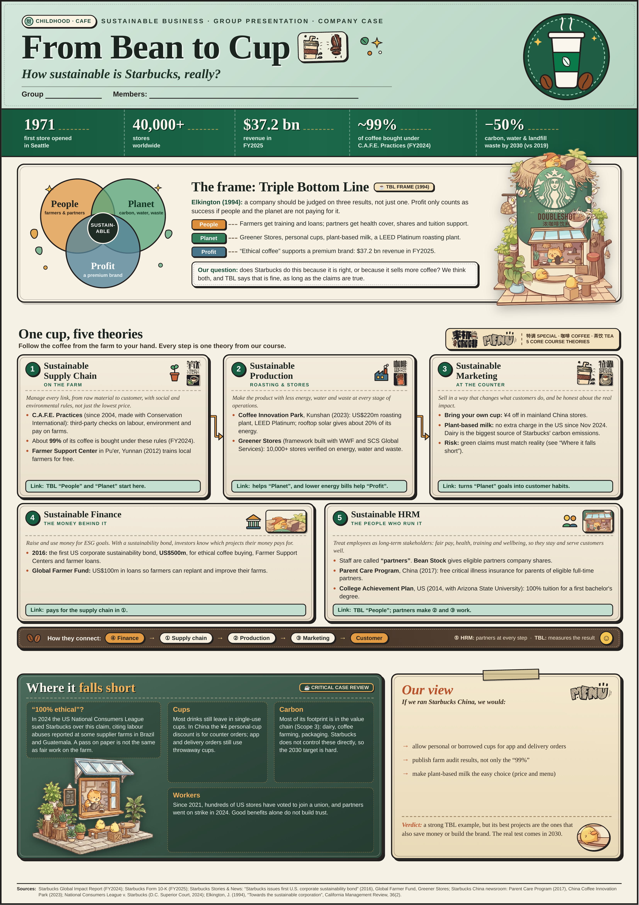
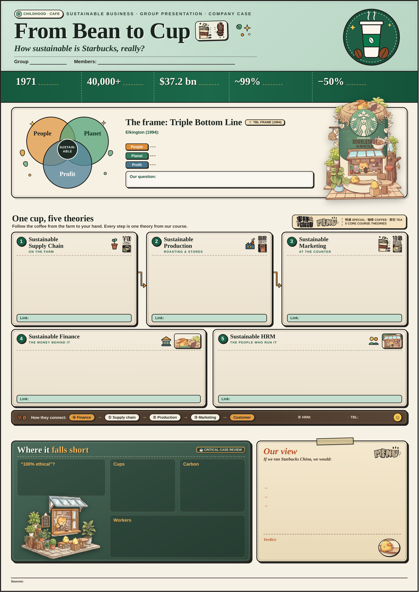

# From Bean to Cup — Starbucks Sustainable Business A2 Posters (420mm × 594mm)

Cute hand-drawn watercolor & kraft-paper menu style A2 posters for the **Sustainable Business — Group Presentation**, integrating cozy café illustrations, hand-drawn coffee stamps, and structured academic frameworks.

## Included Versions (A2 Print-Ready: 420mm × 594mm)

1. **Full Text Version (完整有文字版)**
   - `Starbucks_A2_Poster_Full_Text.html` (interactive, standalone offline HTML with mode switcher & live text editing)
   - `Starbucks_A2_Poster_Full_Text.pdf` (vector A2 print-ready PDF)
   - `Starbucks_A2_Poster_Full_Text.png` (high-res A2 PNG)

2. **Blank Handwriting Template Versions (留空手写模板版)**
   - **2A. Standard Blank Template** (keeps English headings, framework boxes, illustrations, and top 5 key numbers; leaves all body paragraphs blank for handwriting):
     - `Starbucks_A2_Poster_Blank_Template.html` / `.pdf` / `.png`
   - **2B. Pure English Framework Template (No Numbers)** (also leaves the top 5 numbers blank):
     - `Starbucks_A2_Poster_Blank_NoNumbers_Template.html` / `.pdf` / `.png`
   - **2C. Lined Handwriting Template** (adds subtle dashed writing guide lines inside blank boxes):
     - `Starbucks_A2_Poster_Lined_Template.html` / `.pdf` / `.png`

## Preview

| Full Text Version | Blank Template Version |
| :---: | :---: |
|  |  |
